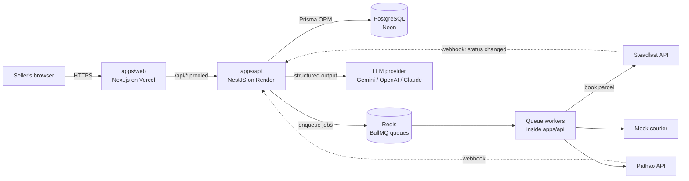

# 02 — Architecture

> One line: **a Next.js frontend talks to a NestJS API; the API owns the PostgreSQL database and pushes slow work (courier booking, AI calls) onto a Redis queue.**

## 1. The big picture



**How to read it:** the browser never talks to the database or couriers directly. Everything goes through the API, which checks *who you are* and *which shop you belong to* on every request.

## 2. Folder layout (monorepo)

```
parcelguard/
├── apps/
│   ├── web/            # Next.js (App Router) — screens only
│   └── api/            # NestJS — business logic, DB, queues, webhooks
├── packages/
│   └── shared/         # Zod schemas + TypeScript types used by BOTH apps
├── docs/               # These design docs + learning notes per feature
├── docker-compose.yml  # Postgres + Redis for local development
├── CLAUDE.md           # Rules for Claude Code in this repo
└── AGENTS.md           # Same rules for Codex
```

A **monorepo** = several apps in one Git repo. We use **pnpm workspaces** so `apps/web` and `apps/api` can both import `packages/shared`.

## 3. Technology choices and why (interview answers)

| Decision | Choice | Why (say this in the interview) |
|---|---|---|
| Frontend | **Next.js + TypeScript + Tailwind + shadcn/ui** | Most-requested React framework in BD job posts; shadcn gives accessible components we own the code of |
| Server state in UI | **TanStack Query** | Caching, loading and error states for API calls without writing it by hand |
| Backend | **NestJS** (separate from Next.js) | Increasingly listed in BD posts; modules + dependency injection keep a growing codebase organised; we need long-running workers and webhooks, which don't fit serverless Next.js routes |
| Database | **PostgreSQL** | Relational data with money in it → transactions, constraints, foreign keys |
| ORM | **Prisma** | Type-safe queries, readable schema file, migrations |
| Validation | **Zod** in `packages/shared` | Write each rule **once**; the form and the API use the same schema |
| Queue | **BullMQ + Redis** | Retries with backoff, delayed jobs, a dashboard; courier APIs are slow and flaky |
| Auth | **Own JWT access + rotating refresh tokens** (httpOnly cookies, argon2 hashes) | We build it ourselves so you can explain every part of it in an interview |
| AI | **Provider interface** + JSON-schema structured output | Swap Gemini/OpenAI/Claude by changing one env var; never trust raw model text |
| Tests | **Jest + Supertest** (API), **Vitest** (shared), **Playwright** smoke test (web) | Unit + API + one real browser path |
| CI | **GitHub Actions** with a Postgres service container | Every push runs lint, type-check and tests |

## 4. Rules every request follows

1. **Authentication** — a guard reads the access token cookie; no token → `401`.
2. **Tenant check** — the request names a shop (`/shops/:shopId/...`); a guard confirms you're a member; not a member → `404` (not 403, so we don't reveal the shop exists).
3. **Authorisation** — a `@Roles('OWNER')` decorator protects owner-only routes.
4. **Validation** — the body is parsed by the shared Zod schema; bad input → `400` with field errors.
5. **Every DB query includes `shopId`.** This single habit is what keeps one shop from seeing another shop's data.

## 5. A tricky deployment detail (worth knowing)

The web app (`*.vercel.app`) and the API (`*.onrender.com`) are on **different domains**. Browsers increasingly block cookies sent between different sites. We avoid the problem by making Next.js **proxy** `/api/*` to the NestJS server, so from the browser's view everything is on one domain and the auth cookies stay first-party.

## 6. Environments

| | Local | Production |
|---|---|---|
| Web | `pnpm dev` → localhost:3000 | Vercel |
| API | `pnpm dev` → localhost:4000 | Render (free web service; workers run in the same process to stay free) |
| Postgres | Docker | Neon (free) |
| Redis | Docker | Render Key Value or Upstash (decided at deploy time by free-tier limits) |
| Secrets | `.env` (never committed) | Each platform's environment-variable settings |
