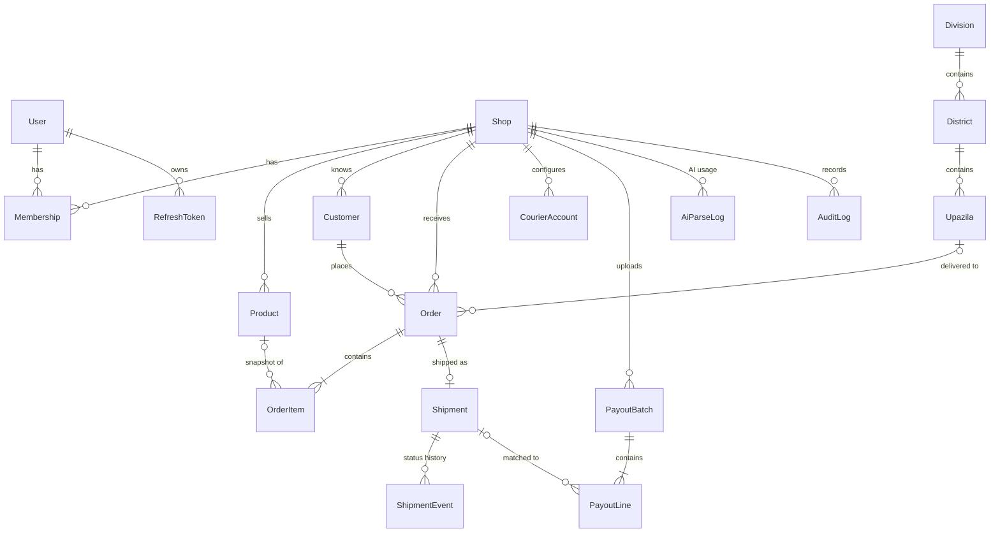
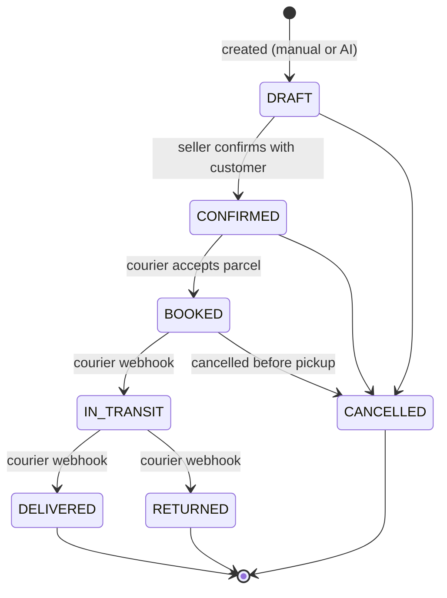

# 03 — Database Design

> One line: **every business table carries a `shopId`, money is stored as whole paisa (integers), and an order's history is never overwritten, only added to.**

## 1. Entity-relationship diagram

## 2. Tables

### Identity and tenancy

| Table | Key columns | Notes |
|---|---|---|
| **User** | `id`, `email` (unique), `passwordHash`, `name`, `createdAt` | Password stored only as an **argon2** hash |
| **Shop** | `id`, `name`, `slug` (unique), `phone`, `pickupAddress`, `createdAt` | The **tenant** |
| **Membership** | `userId`, `shopId`, `role` (`OWNER` \| `MODERATOR`) | Unique on (`userId`, `shopId`). Many-to-many between users and shops |
| **RefreshToken** | `id`, `userId`, `tokenHash`, `expiresAt`, `revokedAt`, `replacedById` | We store a **hash** of the token, never the token. `replacedById` lets us detect a stolen token being reused |

### Catalogue and customers

| Table | Key columns | Notes |
|---|---|---|
| **Product** | `id`, `shopId`, `sku`, `name`, `pricePaisa`, `stock`, `isActive` | Unique on (`shopId`, `sku`) |
| **Customer** | `id`, `shopId`, `name`, `phone`, `createdAt` | `phone` normalised to `+8801XXXXXXXXX`. Unique on (`shopId`, `phone`) |

### Bangladesh locations (seeded once, read-only)

| Table | Key columns |
|---|---|
| **Division** | `id`, `name`, `bnName` |
| **District** | `id`, `divisionId`, `name`, `bnName` |
| **Upazila** | `id`, `districtId`, `name`, `bnName` (thanas included) |

Seeded from a public open dataset of Bangladesh divisions, districts and upazilas (source credited in the seed file).

### Orders

| Table | Key columns | Notes |
|---|---|---|
| **Order** | `id`, `shopId`, `code` (e.g. `PG-000123`), `customerId`, `status`, `source`, `rawMessage`, `addressLine`, `districtId`, `upazilaId`, `addressQuality`, `subtotalPaisa`, `deliveryChargePaisa`, `codAmountPaisa`, `riskScore`, `riskLevel`, `riskReasons` (JSON), `note`, `createdById`, timestamps | `code` unique per shop |
| **OrderItem** | `id`, `orderId`, `productId` (nullable), `nameSnapshot`, `unitPricePaisa`, `quantity` | **Snapshot** of name and price at order time, so editing a product later never changes old orders |

Enums: `OrderStatus` = `DRAFT, CONFIRMED, BOOKED, IN_TRANSIT, DELIVERED, RETURNED, CANCELLED` · `OrderSource` = `MESSENGER, WHATSAPP, PHONE, WEBSITE, MANUAL` · `RiskLevel` = `LOW, MEDIUM, HIGH`.

### Couriers and money

| Table | Key columns | Notes |
|---|---|---|
| **CourierAccount** | `id`, `shopId`, `courier`, `credentialsEncrypted`, `isActive` | API keys **encrypted at rest** (AES-256-GCM) — a DB leak should not leak courier keys |
| **Shipment** | `id`, `orderId` (unique), `courier`, `consignmentId`, `trackingCode`, `status`, `chargePaisa`, `codExpectedPaisa`, `bookedAt`, `lastEventAt` | One order → at most one active shipment |
| **ShipmentEvent** | `id`, `shipmentId`, `status`, `providerEventId`, `rawPayload` (JSON), `occurredAt` | Unique on (`shipmentId`, `providerEventId`) so a **webhook delivered twice is stored once** (idempotency) |
| **PayoutBatch** | `id`, `shopId`, `courier`, `fileName`, `uploadedById`, `totalPaidPaisa`, `createdAt` | One uploaded CSV |
| **PayoutLine** | `id`, `batchId`, `consignmentId`, `amountPaidPaisa`, `shipmentId` (nullable), `matchStatus`, `differencePaisa` | `matchStatus` = `MATCHED, SHORT, OVER, UNKNOWN` |

### Logs

| Table | Key columns | Notes |
|---|---|---|
| **AiParseLog** | `id`, `shopId`, `orderId`?, `provider`, `model`, `input`, `output` (JSON), `valid`, `inputTokens`, `outputTokens`, `latencyMs`, `costMicroUsd`, `error` | Lets us show "AI cost this month" and debug bad parses |
| **AuditLog** | `id`, `shopId`, `actorId`, `action`, `entity`, `entityId`, `before`/`after` (JSON), `createdAt` | Append-only |

## 3. Order lifecycle (state machine)

Any move not drawn here is **rejected by the API** (for example, `DELIVERED → DRAFT`). The allowed moves live in one small table in code with unit tests, so the rule can't be broken from a forgotten corner of the app.

## 4. Design decisions (and the interview question each one answers)

1. **Money as integers in paisa** (`৳1,250.50` → `125050`). *"Why not a float?"* Floats can't represent many decimals exactly (0.1 + 0.2 ≠ 0.3), and you never want rounding errors in money.
2. **`shopId` on every business row** plus composite indexes starting with `shopId`. *"How do you do multi-tenancy?"* Shared database, tenant column, enforced in a guard and in every query.
3. **Snapshots in OrderItem.** *"What happens to old orders when a price changes?"* Nothing; they keep the price at the time of sale.
4. **Unique constraints do the hard work.** Duplicate customers, duplicate webhook events and double shipments are blocked by the database, not just by code that might have a bug.
5. **Hashed refresh tokens with rotation.** *"What if a refresh token is stolen?"* Each use issues a new one; reuse of an old one revokes the whole chain.
6. **Status history is appended, not overwritten** (`ShipmentEvent`, `AuditLog`). *"How do you debug what happened to parcel X?"* Read its events in order.

## 5. Indexes we start with

| Index | Serves |
|---|---|
| `Order (shopId, status, createdAt DESC)` | The main orders list with status filter |
| `Order (shopId, customerId)` | Customer history for the risk score |
| `Customer (shopId, phone)` unique | Find-or-create customer by phone |
| `Shipment (consignmentId)` | Webhook and payout matching |
| `AuditLog (shopId, createdAt DESC)` | Activity feed |

We'll check them with `EXPLAIN ANALYZE` once seed data exists. That's a good thing to show in an interview.
